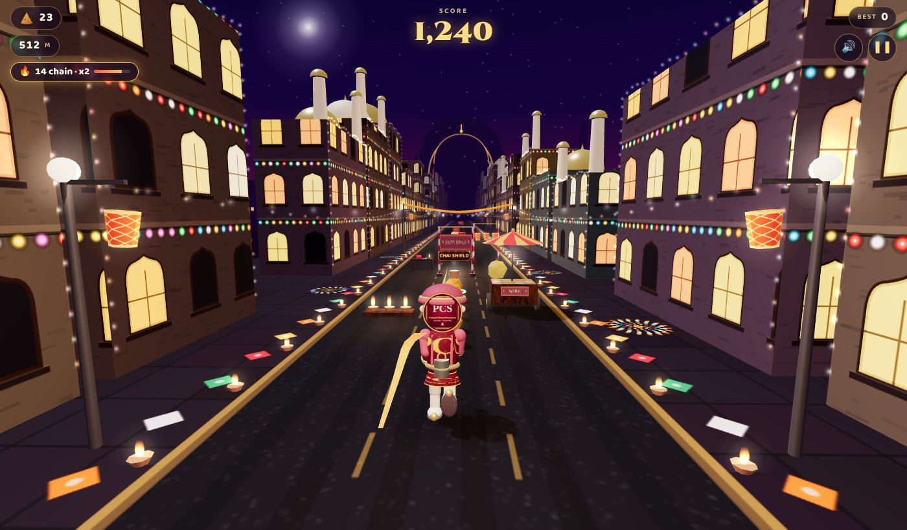

# 🪔 Nawabi Dash — Diwali Samosa Run (Lucknow Edition)

A browser-based 3D endless runner made as a Diwali gift for Team PCS. Run through a Diwali-night
Lucknow street, dodge mithai thelas and torans, collect samosas, and enjoy some proper Lucknowi
Hinglish along the way. Pure HTML + CSS + JavaScript with Three.js. No build step, no installs.



## Play

- **Hosted:** enable GitHub Pages once (see below) and the game is served at `https://<user>.github.io/<repo>/`.
- **Locally:** open `index.html` in Chrome, Edge, Safari or Firefox. (Serving over HTTP works best, e.g. `npx serve .` or `python3 -m http.server`, so the default founder photo loads.)

## Features

- **Your face on the runner.** Upload a photo (or take a selfie on mobile); it becomes the runner's face inside a Nawabi turban. The photo stays in your browser only.
- **Default runner: PCS Sir.** A placeholder monogram ships as `assets/founder.jpg`; replace that file with the real photo (same name) and it is used automatically.
- **"Hurdles pe poster" mode.** Flip a switch and the photo appears as a framed poster on the carts, autos and patakha boxes instead, while you run as a cartoon Nawab.
- **Samosas are the coins.** Regular samosas, golden samosas (5x), and samosa arcs over low obstacles.
- **Power-ups:** Chai Shield (smash through anything for 7 s), Jalebi Magnet (pulls samosas to you), Mithai ka Dabba (2x points).
- **Eight obstacle types:** diya rows, anaar (sparking), patakha boxes, office desks with a DEADLINE laptop (jump); torans and kandil rows (slide); mithai thelas and `UP 32` autos (change lane).
- **Diwali-night Lucknow:** lit Awadhi facades with string lights, domes and minarets, kerb diyas, rangolis, marigold torans, paper lanterns, a hazy Rumi-Darwaza skyline, rockets and fireworks.
- **Lucknowi Hinglish everywhere:** taglines, praise for samosa streaks, near-miss lines, milestone shout-outs (Hazratganj, Rumi Darwaza, Bhool Bhulaiya, Gomti...), game-over banners and ranks from *Aminabad Rookie* to *Nawab-e-Lucknow*.
- **A Subway-Surfers-style figure:** big head, chunky hands and sneakers, rounded limbs, kurta with gold trim, a 3D Nawabi turban, a samosa tiffin on the back. The photo is a face disc that always faces the camera, so the runner reads from behind.
- **Game feel:** articulated runner with a real run cycle, jump tuck, forward-roll slide and tumble crash; trailing dupatta; squash and stretch on landings; 3-2-1 countdown with an intro camera swing; hit-stop and slow motion on a crash; camera bank, FOV kicks and speed streaks; samosas fly into the HUD counter; input buffering so a jump pressed just before landing still fires.
- **Samosa chains:** keep collecting without a gap and the multiplier climbs (x2 at 10, x3 at 20, x4 at 30). Stacks with Mithai 2x.
- **Tutorial prompts** on your first two runs ("Kood jaiye!", "Slide kijiye!", "Lane badliye!") timed to the first obstacle of each kind.
- **Real shadows** on desktop (soft shadow map), flickering diya point lights near the runner, and adaptive quality that lowers resolution, then shadows, if a device can't hold the frame rate.
- **Synthesised sound:** dhol-and-pluck background loop that adds layers as you go further, and all effects generated with WebAudio, no audio files. Mute button in the HUD.
- **Optional rigged character:** drop a Mixamo (or any) GLB at `models/runner.glb` and it replaces the procedural body, with the photo head following its head bone. See `models/README.md`.
- **Local leaderboard**, best score, share-to-WhatsApp text, mobile swipe controls, pause on tab switch with a 3-2-1 resume.

## Controls

| Action | Desktop | Mobile |
|---|---|---|
| Change lane | ← → or A / D | swipe left / right |
| Jump | ↑, W or Space | swipe up or tap |
| Slide | ↓ or S (mid-air: slam down) | swipe down |
| Pause | P or Esc | ❚❚ button |

## Hosting on GitHub Pages (one time)

1. Open the repository **Settings → Pages**.
2. Under **Build and deployment**, set **Source** to **GitHub Actions**.
3. Push to `main` (or run the *Deploy to GitHub Pages* workflow manually from the Actions tab).

The workflow in `.github/workflows/deploy-pages.yml` publishes the repository root as a static site.
Any static host works too: Netlify Drop, Vercel, Cloudflare Pages, or `npx serve .` on the office Wi-Fi.

## Customising

| What | Where |
|---|---|
| Founder photo | `assets/founder.jpg` (see `assets/README.md`) |
| Hinglish lines, ranks, milestones | `js/config.js` → `ND.TEXT` |
| Speed, jump, spawn pacing, power-up durations | `js/config.js` → `ND.CFG` |
| Banner texts on torans | `js/config.js` → `ND.TEXT.bannerTexts` |
| Colours, fonts, UI | `css/style.css` (`:root` tokens) |
| Obstacles, pickups, the runner rig | `js/entities.js` |
| Rigged GLB runner (optional) | `models/runner.glb`, loader in `js/models.js` |
| Street, buildings, fireworks | `js/world.js` |
| Textures (all drawn on canvas) | `js/textures.js` |

## Project layout

```
index.html          markup for HUD and screens
css/style.css       styling (Diwali-night palette, Cinzel Decorative + Baloo 2)
js/config.js        tuning constants + Hinglish text banks
js/audio.js         WebAudio SFX + music loop
js/textures.js      canvas-generated textures (road, facades, samosa, banners, face sprite...)
js/world.js         sky, street segments, buildings, diyas, torans, fireworks
js/models.js        optional GLB runner loader (Mixamo drop-in)
js/entities.js      player rig, obstacles, pickups, particles, floating text, speed streaks
js/game.js          game loop, spawner, collisions, scoring, input, camera
js/ui.js            screens, HUD, photo upload, leaderboard, share
assets/             founder photo placeholder
models/             drop models/runner.glb here for a rigged character (see models/README.md)
```

Three.js r128 is loaded from cdnjs; everything else is in this repository.

Shubh Deepawali! Is Diwali, Prakash hi Prakash. ✨
